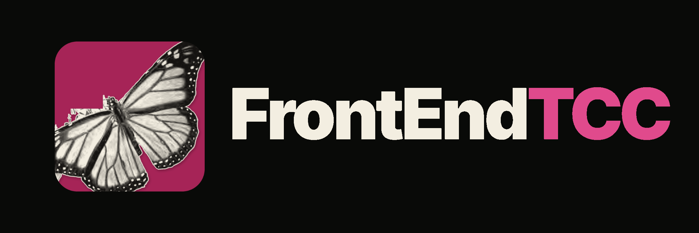
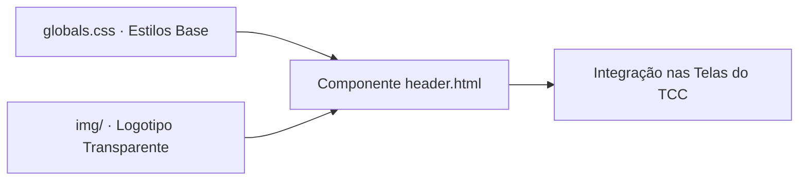

<p align="center"></p>

<p align="center">Interface web desenvolvida para o trabalho de conclusão de curso.</p>


<p align="center"><a href="#visão-geral">Visão geral</a> &nbsp;·&nbsp; <a href="#recursos">Recursos</a> &nbsp;·&nbsp; <a href="#como-executar">Como executar</a></p>

---

<a id="explore-o-projeto"></a>

## Por onde começar


- **[Página](header.html)** — Marcação HTML da interface.
- **[Estilos](globals.css)** — Estilos compartilhados da página.
- **[Imagens](img)** — Recursos visuais usados no front-end.


<a id="visão-geral"></a>

## Sobre o projeto

Este repositório preserva o componente base de interface (header.html), a folha de estilos global (globals.css) e o logotipo com fundo transparente (img/), estruturados para integração direta às páginas principais do projeto.

<a id="recursos"></a>

## Recursos

**Cabeçalho reutilizável**<br>
header.html estrutura a barra superior com marca e links de navegação prontos para inclusão nas páginas.

**Reset e estilos globais**<br>
globals.css padroniza margens, tipografia, cores e comportamento responsivo dos elementos base.

**Ativo gráfico otimizado**<br>
Logotipo em PNG com fundo transparente na pasta img/ para sobreposição limpa em diferentes temas.

<a id="tecnologias"></a>

## Tecnologias

- **HTML5 (header.html)** para marcação semântica do componente de topo;
- **CSS3 (globals.css)** para regras de layout, flexbox e variáveis visuais.

## Arquitetura





## Estrutura do repositório


```text
frontEndTCC/
├── assets/
│   └── identity/banner.png               Banner do projeto
├── img/                            Logotipo e recursos visuais da barra superior
├── globals.css                     Regras globais de estilização e layout
├── header.html                     Estrutura HTML do componente de cabeçalho
└── README.md
```


<a id="como-executar"></a>

## Como executar

1. Clone o repositório:
   ```bash
   git clone https://github.com/arthurlynow098/frontEndTCC.git
   ```
2. Abra o arquivo header.html no navegador ou com a extensão *Live Server* do VS Code para inspecionar o componente renderizado junto ao globals.css.

---

<p align="center">
  <a href="https://github.com/arthurlynow098">GitHub</a> &nbsp;·&nbsp;
  <a href="https://arthurentsev.vercel.app/">Portfólio</a> &nbsp;·&nbsp;
  <a href="https://www.linkedin.com/in/entsevarthur/">LinkedIn</a>
</p>

## Identidade visual e créditos

**Borboleta** — Transformação e expressão visual. [Logo em PNG](assets/identity-v2/logo.png).

Identidade organizada a partir das artes fornecidas por Arthur Entsev. Direção visual e organização documental inspiradas em [LynowCut](https://github.com/arthurlynow098/LynowCut) e [LynowCatch](https://github.com/arthurlynow098/LynowCatch). Tipografia **Inter**, com licença SIL Open Font License em [Inter-OFL.txt](assets/identity-v2/Inter-OFL.txt).
