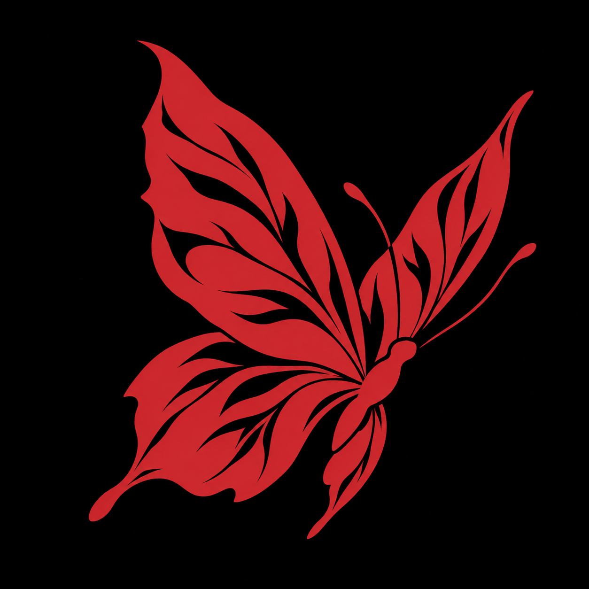

frontEndTCC

---

# frontEndTCC

## Sobre o projeto

Recursos iniciais de interface para um TCC: fragmento HTML de cabeçalho, estilos globais e imagem. A árvore atual não apresenta uma aplicação completa com ponto de entrada.

## Como explorar

Consulte `header.html` e `globals.css`. Como não há página inicial completa na raiz, esses recursos precisam ser integrados ao restante da interface.

## Mapa do repositório

- [globals.css](globals.css)
- [header.html](header.html)
- [img](img) — diretório

## Desenvolvimento

As instruções acima descrevem os arquivos disponíveis. A execução da aplicação não foi validada nesta revisão de documentação.

---

Estudo · construção · evolução <a href="https://github.com/arthurlynow098">Perfil</a> · <a href="https://arthurentsev.vercel.app/">Portfólio</a>

