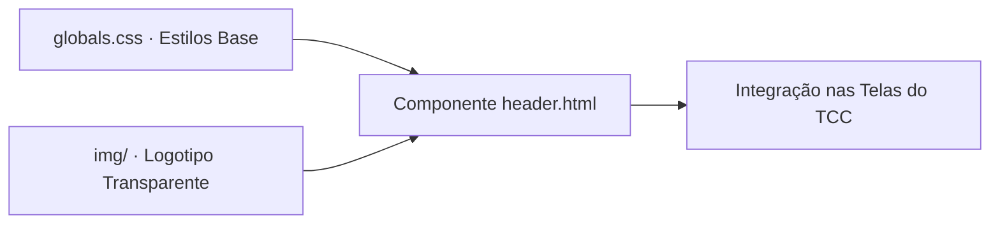

<p align="center">
  
</p>

<p align="center">Interface web desenvolvida para o trabalho de conclusão de curso.</p>

<p align="center">
  
  
  
</p>

<p align="center"><a href="#visão-geral">Visão geral</a> &nbsp;·&nbsp; <a href="#recursos">Recursos</a> &nbsp;·&nbsp; <a href="#como-executar">Como executar</a></p>

---

## Visão geral

Este repositório preserva o componente base de interface (header.html), a folha de estilos global (globals.css) e o logotipo com fundo transparente (img/), estruturados para integração direta às páginas principais do projeto.

## Recursos

| Recurso | Como funciona |
|---|---|
| Cabeçalho reutilizável | header.html estrutura a barra superior com marca e links de navegação prontos para inclusão nas páginas. |
| Reset e estilos globais | globals.css padroniza margens, tipografia, cores e comportamento responsivo dos elementos base. |
| Ativo gráfico otimizado | Logotipo em PNG com fundo transparente na pasta img/ para sobreposição limpa em diferentes temas. |

## Tecnologias

- **HTML5 (header.html)** para marcação semântica do componente de topo;
- **CSS3 (globals.css)** para regras de layout, flexbox e variáveis visuais.

<details>
<summary>Arquitetura</summary>



</details>

<details>
<summary>Estrutura do repositório</summary>

```text
frontEndTCC/
├── assets/
│   └── project-animal.png          Emblema do projeto
├── img/                            Logotipo e recursos visuais da barra superior
├── globals.css                     Regras globais de estilização e layout
├── header.html                     Estrutura HTML do componente de cabeçalho
└── README.md
```

</details>

## Como executar

1. Clone o repositório:
   ```bash
   git clone https://github.com/arthurlynow098/frontEndTCC.git
   ```
2. Abra o arquivo header.html no navegador ou com a extensão *Live Server* do VS Code para inspecionar o componente renderizado junto ao globals.css.

---

<p align="center">
  <a href="https://github.com/arthurlynow098">GitHub</a> &nbsp;·&nbsp;
  <a href="https://arthurentsev.vercel.app/">Portfólio</a> &nbsp;·&nbsp;
  <a href="https://www.linkedin.com/in/entsevarthur/">LinkedIn</a>
</p>
