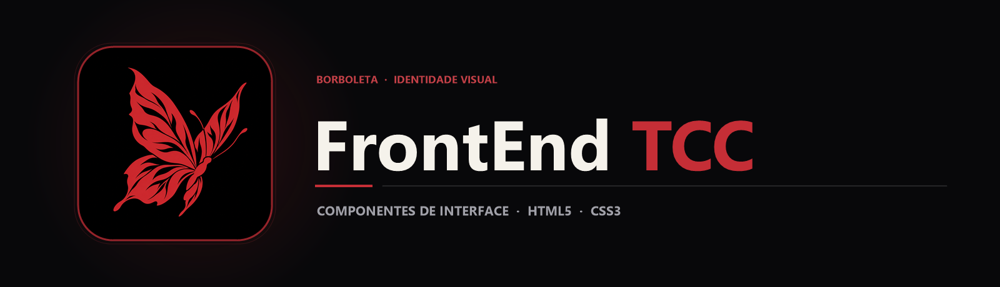

  

  Módulo de cabeçalho navegacional e folha de estilos globais em HTML5 e CSS3 desenvolvidos para a identidade visual do TCC.

  
  
  

## Sobre o projeto

Durante a construção de uma aplicação web em equipe para o **Trabalho de Conclusão de Curso (TCC)**, padronizar o cabeçalho de navegação e o reset de estilos globais garante consistência visual entre todas as telas do sistema.

Este repositório preserva o componente base de interface (header.html), a folha de estilos global (globals.css) e o logotipo com fundo transparente (img/), estruturados para integração direta às páginas principais do projeto.

## Principais recursos

| Recurso | Como funciona |
|---|---|
| Cabeçalho reutilizável | header.html estrutura a barra superior com marca e links de navegação prontos para inclusão nas páginas. |
| Reset e estilos globais | globals.css padroniza margens, tipografia, cores e comportamento responsivo dos elementos base. |
| Ativo gráfico otimizado | Logotipo em PNG com fundo transparente na pasta img/ para sobreposição limpa em diferentes temas. |

## Tecnologias

  
  
  

- **HTML5 (header.html)** para marcação semântica do componente de topo;
- **CSS3 (globals.css)** para regras de layout, flexbox e variáveis visuais.

## Arquitetura

`mermaid
flowchart LR
    A[globals.css · Estilos Base] --> C[Componente header.html]
    B[img/ · Logotipo Transparente] --> C
    C --> D[Integração nas Telas do TCC]
`

## Estrutura do repositório

`	ext
frontEndTCC/
├── assets/
│   ├── banner.png                  Banner principal do repositório
│   └── project-animal.png          Símbolo da borboleta
├── img/                            Logotipo e recursos visuais da barra superior
├── globals.css                     Regras globais de estilização e layout
├── header.html                     Estrutura HTML do componente de cabeçalho
└── README.md
`

## Executando o código

1. Clone o repositório:
   `ash
   git clone https://github.com/arthurlynow098/frontEndTCC.git
   `
2. Abra o arquivo header.html no navegador ou com a extensão *Live Server* do VS Code para inspecionar o componente renderizado junto ao globals.css.

---

Estudo · construção · evolução <a href="https://github.com/arthurlynow098">Perfil</a> · <a href="https://arthurentsev.vercel.app/">Portfólio</a> · <a href="https://www.linkedin.com/in/entsevarthur/">LinkedIn</a>

